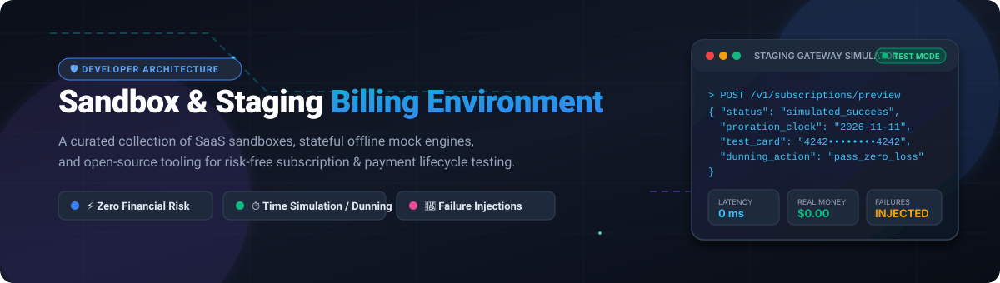

# 🧪 Awesome Sandbox & Staging Billing Environment 💳⚡

  <strong>A battle-tested, curated collection of Sandbox and Staging Billing Environment platforms, stateful offline mock engines, and open-source simulators for testing payment flows, dunning lifecycle, and subscription logic without risking real money or customer data.</strong>

  
  
  
  

---

## 🧭 Table of Contents

- [🌐 Sector Overview & Market Dynamics](#-sector-overview--market-dynamics)
- [🏢 SaaS & Hosted Billing Sandboxes](#-saas--hosted-billing-sandboxes)
  - [📊 SaaS Platforms Feature & Pricing Breakdown](#-saas-platforms-feature--pricing-breakdown)
  - [🔍 Detailed SaaS Profiles](#-detailed-saas-profiles)
- [💻 Open-Source Software & Mock Frameworks](#-open-source-software--mock-frameworks)
- [⚖️ Architecture & Feature Comparison](#-architecture--feature-comparison)
- [🎯 Best Practices for Billing Sandbox Testing](#-best-practices-for-billing-sandbox-testing)
- [🤝 Contributing](#-contributing)
- [📄 License](#-license)

---

## 🌐 Sector Overview & Market Dynamics

The global **billing and subscription management software market** is estimated at **$7.2B–$8.5B in 2024–2025** and is projected to surpass **$20B by 2030** (growing at a compound annual growth rate of 14%–16.4%), propelled by the mass transition toward consumption-based billing, multi-tier SaaS, and complex global tax/e-invoicing mandates.

The market is **moderately fragmented yet features a concentrated, winner-take-most core**: mega-scale payment processing and developer gateway layers are dominated by a handful of infrastructure giants (such as **Stripe**, **PayPal**, and **Adyen**), while the specialized subscription lifecycle, dunning orchestration, and local payment gateway spaces remain fragmented with competitive contenders like **Chargebee**, **Rebilly**, and emergent open-source platforms.

---

## 🏢 SaaS & Hosted Billing Sandboxes

Commercial, cloud-hosted billing environments provide dedicated test modes, virtual bank accounts, and simulated card gateways. Below is a sorted breakdown based on company size (market valuation / annual revenue), highlighting transparent entry-level pricing and strict free tier limits.

### 📊 SaaS Platforms Feature & Pricing Breakdown

| 🏷️ Company / Sandbox Platform | 🏢 Scale (Valuation / Revenue) | 💵 Starting Tier Pricing | 🎁 Free Tier Limit / Trial Duration | ⏱️ Time Simulation | 🧪 Failure Injection |
|---|---|---|---|:---:|:---:|
| **PayPal Sandbox** | **~$80B Valuation** (~$31.8B Annual Rev) | **$0/mo** + 2.9% + $0.30 per live transaction | **Permanent Free Sandbox Access** (unlimited virtual buyer/seller test accounts; live mode charges pay-as-you-go per transaction) | ❌ | ✅ Account balances & state triggers |
| **Stripe Test Mode** | **$70B Valuation** (~$4.2B Net Rev) | **$0/mo** + 2.9% + $0.30 per live transaction | **Permanent Free Test Mode Access** (unlimited API calls and test card transactions; live mode charges 0% platform base fee) | ❌ | ✅ Extensive test cards & 3DS friction flows |
| **Square Sandbox** | **~$45B Valuation** (~$23.9B Annual Rev) | **$0/mo** + 2.6% + $0.10 per live transaction | **Permanent Free Sandbox Access** (unlimited API Explorer sandbox requests, sandbox OAuth tokens, and test cards) | ❌ | ✅ Specific CVV/amount failure values |
| **Adyen Test Platform** | **~$40B Valuation** (~€1.8B Net Rev) | **€100/mo minimum platform invoice** + €0.11 + interchange fee | **Permanent Free Test Environment** (unlimited simulated multi-currency and regional acquirer routing tests; test account never expires) | ❌ | ✅ Granular raw acquirer decline codes |
| **Authorize.Net Sandbox** | **~$10B Est. Division Scale** (Visa Subsidiary) | **$25/mo gateway fee** + $0.10 per txn (or 2.9% + $0.30 all-in-one) | **Permanent Free Developer Sandbox** ($0/mo developer account, zero transaction fees for simulated test card numbers) | ❌ | ✅ Modulo 10 Luhn check & test amount triggers |
| **Checkout.com Sandbox** | **$12B Valuation** (~$750M Net Rev Run-Rate) | **Custom Volume Pricing** (starts at ~0.95% + €0.02 to 1.99% per txn) | **Permanent Free Sandbox Access** (full developer portal test keys, test webhook events, and test 3DS card simulations) | ❌ | ✅ Soft and hard gateway decline simulation |
| **Chargebee Test Site** | **$3.5B Valuation** (~$202M Annual Rev) | **$599/mo** (Performance plan billed annually for scaling teams) | **Starter Plan Free up to $250,000 cumulative lifetime billing** (0.75% overage fee applies beyond $250k; includes full Test Site & Time Machine) | ✅ Time Machine | ✅ Chargebee Test Gateway & smart routing |
| **Braintree Sandbox** | **~$3.0B Est. Scale** (PayPal Subsidiary) | **$0/mo** + 2.59% + $0.49 per live transaction | **Permanent Free Sandbox Account** (unlimited sandbox API calls, virtual merchant dashboard, and amount-based trigger testing) | ❌ | ✅ Amount-based trigger rules ($2000+ declines) |
| **FastSpring Test Mode** | **~$100M+ Annual Rev** (Backed by Accel-KKR) | **Revenue share commission** (~3.9%–5.9% per transaction) | **14-day assisted demo trial for production MoR** (unlimited sandbox storefront and test-order execution before contract launch) | ❌ | ✅ Simulated test orders & tax exemption modes |
| **Rebilly Sandbox** | **~$6M–$7M Annual Rev** (Bootstrapped) | **$125/mo** base plan + ~1% volume collection fee | **30-Day Free Trial of Pro Plan** (includes complete sandbox environment with time-machine-like event triggers; no permanent free tier) | ✅ Event simulation | ✅ Custom gateway response simulation |

---

### 🔍 Detailed SaaS Profiles

#### 💳 Chargebee Test Site
* **Type:** Full-featured billing sandbox with time simulation.
* **Overview:** Chargebee equips every account with paired environments: a **Live Site** and an isolated **Test Site**. The Test Site allows engineering teams to construct pricing matrices, mock plans, register customer entities, and execute complete subscription lifecycles without polluting production databases.
* **Key Capabilities:**
  * **Time Machine:** Virtually travel forward in time to validate multi-phase dunning schedules, automated invoicing, renewal webhooks, and grace periods without waiting for real-world days or months to pass.
  * **Test Payment Gateway:** Replicates instant authorizations, insufficient funds, expired cards, and gateway timeout conditions.
  * **AI Catalog Population:** Auto-populates products, currencies, and add-ons by parsing public pricing URLs.
* **Best for:** SaaS startups and enterprises managing complex recurring billing, usage proration, and dunning workflows.

#### 💳 Stripe Test Mode
* **Type:** High-fidelity developer gateway sandbox with comprehensive test card library.
* **Overview:** Stripe Test Mode provides a frictionless developer environment activated via dashboard toggles or API keys (`sk_test_...`). Test transactions mirror live operational processing exactly without settling real funds.
* **Key Capabilities:**
  * **Test Card Library:** Simulates specific fraud triggers, insufficient balance (`generic_decline`, `insufficient_funds`), incorrect CVC, and frictionless or challenge 3D Secure 2 (3DS2) biometric/OTP flows.
  * **Stripe CLI & Webhook Triggering:** Dispatch mock webhooks locally (`stripe trigger payment_intent.succeeded`) directly into localhost endpoints without requiring cloud tunnels.
  * **Test Clocks:** Simulate billing cycles, proration calculation, and subscription phase transitions across advance timestamps.
* **Best for:** Developers requiring precise, granular control over card processing outcomes, compliance verification, and frictionless webhook integration.

#### 💳 PayPal Sandbox
* **Type:** Full virtual buyer and merchant ecosystem.
* **Overview:** The PayPal Sandbox operates on dedicated developer infrastructure (`api-m.sandbox.paypal.com` and `sandbox.paypal.com`), offering complete buyer and business merchant account mocks.
* **Key Capabilities:**
  * **Virtual Account Portfolios:** Generate pre-funded virtual customer accounts with customizable bank balances and credit lines.
  * **Two-Sided Flow Verification:** Log in as both consumer and merchant to inspect money movement, disputes, refunds, and instant payment notifications (IPN / Webhooks).
* **Best for:** Engineering teams integrating PayPal buttons, multi-party marketplace payouts, and dual-party dispute resolution workflows.

#### 💳 Braintree Sandbox
* **Type:** Gateway testbed featuring automated amount-triggered decline scenarios.
* **Overview:** A sandbox subsidiary environment designed for rapid testing of card verification, tokenization, and digital wallets (Apple Pay, Google Pay).
* **Key Capabilities:**
  * **Amount-Based Triggering:** Authorizations automatically produce deterministic test outcomes based on dollar amounts (e.g., $0.01–$1,999.99 for authorized success, $2,000.00 for Do Not Honor decline, $2,001.00 for Insufficient Funds).
  * **Settlement State Control:** Force transactions into authorized, submitted for settlement, settled, or voided states via dashboard controls.
* **Best for:** Engineers validating automated dispute pipelines and predictable unit tests without requiring custom mock headers.

#### 💳 Square Sandbox
* **Type:** Point-of-Sale (POS) and eCommerce developer environment.
* **Overview:** Provides an interactive web-based API Explorer directly tied to active sandbox credentials for quick API validation.
* **Key Capabilities:**
  * **Interactive Explorer:** Execute sandbox requests directly from API reference documentation using real test tokens.
  * **Omnichannel Testing:** Test unified transactions spanning online checkouts, in-person hardware simulations, and invoice billing.
* **Best for:** Hybrid businesses synchronizing online SaaS billing with physical point-of-sale systems.

#### 💳 Adyen Test Platform
* **Type:** Global enterprise payment engine testbed.
* **Overview:** An enterprise-grade staging platform mirroring Adyen's unified commerce setup across multi-currency and global card schemes.
* **Key Capabilities:**
  * **Acquirer Response Simulation:** Emulate granular raw response codes across Visa, Mastercard, American Express, and 250+ local alternative payment methods (iDEAL, Klarna, WeChat Pay).
  * **Refusal Reason Emulation:** Test raw banking error handling including 3DS fallback, CVC mismatches, and risk engine blocks.
* **Best for:** Large enterprise engineering teams managing multi-region transaction routing and localized alternative payment schemes.

#### 💳 Authorize.Net Sandbox
* **Type:** Legacy and modern gateway developer simulator.
* **Overview:** Completely isolated test environment for validating Authorize.Net API integrations, Customer Information Manager (CIM), and Automated Recurring Billing (ARB).
* **Key Capabilities:**
  * **CIM Tokenization:** Test customer profile generation and recurrent subscription billing schedules.
  * **Deterministic Test Inputs:** Predictable card inputs designed to simulate approval, decline, and merchant configuration errors.
* **Best for:** Traditional merchant gateway integrations, healthcare billing, and legacy enterprise software stacks.

#### 💳 Checkout.com Sandbox
* **Type:** Cloud-native global acquiring and payment orchestration sandbox.
* **Overview:** High-velocity payment orchestration environment providing deep visibility into raw ISO 8583 error codes and webhook mechanics.
* **Key Capabilities:**
  * **Granular Decline Mapping:** Simulate 3DS challenge requirements, risk rule triggers, and card network chargebacks.
  * **Full API & Dashboard Sandbox:** Isolated dashboard environment for verifying customer disputes, refunds, and settlement reports.
* **Best for:** High-volume digital platforms, international remittances, and multi-entity marketplaces.

#### 💳 FastSpring Test Mode
* **Type:** Full Merchant of Record (MoR) staging environment.
* **Overview:** Designed specifically for digital downloads, SaaS subscriptions, and software vendors needing to test end-to-end checkout, VAT/sales tax automation, and international invoicing.
* **Key Capabilities:**
  * **Test Orders:** Place live-lookalike orders using dedicated test payment credentials without billing actual credit accounts.
  * **Tax Exemption Verification:** Test location-based tax assessments (EU VAT, US sales taxes) across simulated country IPs.
* **Best for:** Software companies outsourcing global tax remittance, compliance, and localized SaaS checkout logic.

#### 💳 Rebilly Sandbox
* **Type:** Subscription orchestration and payment routing sandbox.
* **Overview:** Built for sophisticated subscription billing logic, cross-gateway routing rules, and churn reduction strategies.
* **Key Capabilities:**
  * **Gateway Mock Switch:** Route payments between multiple test payment processors to evaluate failover and cascading routing logic.
  * **Event Simulation:** Trigger arbitrary subscription states (delinquent, canceled, renewed) to verify downstream integrations.
* **Best for:** High-growth subscription architectures requiring intelligent gateway failover and churn prevention modeling.

---

## 💻 Open-Source Software & Mock Frameworks

Self-hosted, community-driven tools for mocking payment gateways, simulating billing engines, and running offline test suites. 

> *The open-source table below is strictly sorted by **GitHub Star Count (descending)**. Every repository badge links directly to its live GitHub stargazers directory.*

| 🛠️ Open-Source Project | 🌟 GitHub Stars (Social Badge) | 🧰 Technology Stack | 📜 Open-Source License | 💡 Core Purpose & Sandbox Utility |
|---|:---:|---|---|---|
| **[Lago](https://github.com/getlago/lago)** |  | Ruby on Rails, Go | AGPL-3.0 | Complete open-source metering and usage-based subscription billing platform. Deployable locally via Docker to simulate hybrid pricing, proration, and invoice generation in self-hosted CI/CD pipelines. |
| **[Kill Bill](https://github.com/killbill/killbill)** |  | Java | Apache-2.0 | The open-source standard for recurring billing and payment orchestration. Includes a built-in payment plugin architecture, test payment gateway stub, and deterministic time clock to advance billing intervals instantly. |
| **[OpenMeter](https://github.com/openmeterio/openmeter)** |  | Go, ClickHouse | Apache-2.0 | Cloud-native, high-throughput usage metering engine for AI models and developer infrastructure. Allows spinning up local staging instances to test usage limits, quota alerts, and Stripe webhook syncing without internet connectivity. |
| **[stripe-mock](https://github.com/stripe/stripe-mock)** |  | Go | MIT | Official mock HTTP server written by Stripe. Reads OpenAPI specifications to generate instantaneous local responses matching Stripe's API contract. Eliminates network latency, rate limits, and external dependencies in unit test suites. |
| **[acquiremock](https://github.com/ashfromsky/acquiremock)** |  | Python, FastAPI, Docker | MIT | Standalone, containerized mock payment gateway featuring a local browser checkout UI, mock OTP SMS verification, cryptographic HMAC webhook signatures, and deterministic card success/failure simulation. |
| **[seahaven-stripe-world](https://github.com/Kiln-AI/Seahaven)** |  | Python | Apache-2.0 | Stateful Stripe environment created by Kiln AI for AI agents and reinforcement learning evals. Unlike stateless mocks, it maintains full customer, plan, and invoice database state across API operations with deterministic snapshot resets. |
| **[paymock](https://github.com/chitrakulkarni2830/payMock)** |  | JavaScript, Node.js, Express | MIT | Full-stack payment gateway simulator and offline testbed. Replicates end-to-end payment submission, database persistence, status callbacks, and edge-case failure handling for payment integration pipelines. |

---

## ⚖️ Architecture & Feature Comparison

| Solution | Model | Time Travel Simulation | Offline / Air-Gapped | Failure & Decline Injection | Best For |
|---|---|:---:|:---:|:---:|---|
| **Chargebee Test Site** | SaaS / Cloud | ✅ Time Machine | ❌ | ✅ Gateway Test Rules | Complex dunning, proration & renewal testing |
| **Stripe Test Mode** | SaaS / Cloud | ✅ Test Clocks | ❌ | ✅ Test Card Library & 3DS | Comprehensive payment acceptance testing |
| **Adyen / PayPal / Braintree** | SaaS / Cloud | ❌ | ❌ | ✅ Amount & Code Mappings | Multi-provider & regional payment testing |
| **stripe-mock** | Open-Source / Self-Hosted | ❌ | ✅ Fast Local Mock | ❌ Contract Only | Millisecond-level local unit test suites |
| **Kill Bill** | Open-Source / Self-Hosted | ✅ Virtual Clock | ✅ Full Stack | ✅ Plugin Error Injection | Complete self-hosted billing architecture |
| **Lago** | Open-Source / Self-Hosted | ❌ | ✅ Full Stack | ✅ Webhook Error Triggering | Metered SaaS & usage-based billing staging |
| **acquiremock** | Open-Source / Self-Hosted | ❌ | ✅ Full Stack | ✅ UI Decline / OTP Timeout | Local end-to-end checkout & webhook testing |
| **seahaven-stripe-world** | Open-Source / Self-Hosted | ✅ Frozen Timestamps | ✅ Full Stack | ✅ Stateful Injections | AI autonomous agent evals & stateful testing |

---

## 🎯 Best Practices for Billing Sandbox Testing

1. **🔒 Never Use Real Financial Identifiers:** Always verify your integration uses isolated test API keys (`sk_test_...`) and pre-configured test card numbers. Ensure zero real credit card PANs ever pass through staging or development logs.
2. **⏰ Validate Subscription Edge Cases with Time Simulation:**
   * Subscription upgrade/downgrade mid-cycle with immediate vs. end-of-period proration.
   * Grace period logic and automated card retry schedules during dunning.
   * Subscription cancellation with scheduled termination vs. instant revocation.
3. **💥 Test Unhappy Paths First:**
   * Insufficient funds (`402 Payment Required`).
   * 3D Secure biometric challenge declines or abandoned customer sessions.
   * Webhook retries with delayed or out-of-order network arrival.
4. **🔁 Enforce Idempotency:**
   * Every billing mutation API call should carry unique `Idempotency-Key` headers to ensure network retries never produce duplicate charges.
5. **⚡ Combine Unit Mocks with End-to-End Sandboxes:**
   * Use lightweight, offline tools like `stripe-mock` for instant CI pull-request checks (sub-second execution).
   * Reserve cloud SaaS staging sandboxes for nightly integration pipelines and pre-release smoke testing.

---

## 🤝 Contributing

Contributions are warmly welcomed! If you maintain or use a billing sandbox, payment mock, or subscription testing tool that should be featured:

1. 🍴 Fork the repository.
2. 🌿 Create a feature branch: `git checkout -b feat/add-billing-tool`.
3. 📝 Update `README.md` with your tool (including accurate licensing, pricing, and GitHub star badges).
4. 🚀 Open a Pull Request with a clear description of the project's unique testing capabilities.

---

## 📄 License

This repository and curated list are published under the [Creative Commons Zero v1.0 Universal (CC0 1.0)](https://creativecommons.org/publicdomain/zero/1.0/) public domain dedication.

---

  <strong>⭐ If this curated list helped you build more resilient billing infrastructure, please star this repository! ⭐</strong>

